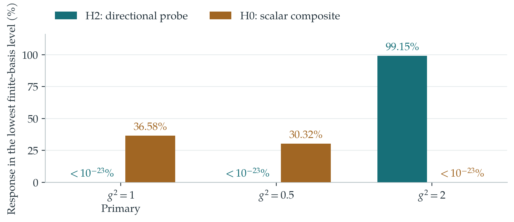
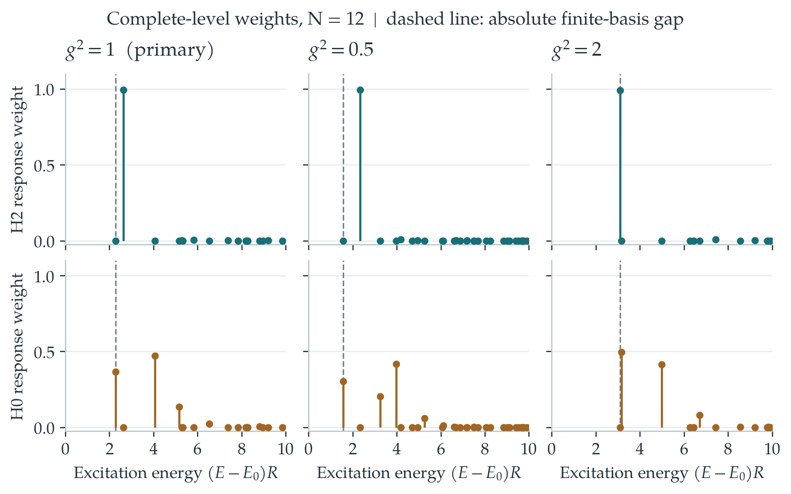

# Helike as a Probe of a Quantum Yang-Mills Model

**23 November 2026 | Verified finite-cutoff survey | Convergence: UNRESOLVED**

[Read the illustrated report (PDF)](report.pdf) · [Editable LaTeX](report.tex) ·
[Detailed numerical results](../../research/helike-quantum-probe-results-2026-11-23.md) ·
[Plan for using the evidence inside GIGI](../../research/ym-evidence-continuum-gigi-plan-2026-11-23.md)

## The result and its boundary

A probe built from Helike's geometry was applied to a published SU(2) quantum
Yang-Mills matrix model, with its Hamiltonian unchanged. At the largest tested
basis and strongest coupling, 99.154% of the directional channel's finite-basis
excited response lies in the independently computed lowest level. At the other
two couplings, a separately defined scalar composite reaches the lowest level.

The finite matrices and their results have been verified. The approximation has
not converged: energies still move with cutoff, omitted-state residuals are too
large, and the lowest-level ordering changes during refinement. This is not a
converged model gap or a claim about the full four-dimensional continuum theory.



## Reusable paper assets

Every figure has PDF, SVG and PNG versions. Use PDF for LaTeX inclusion and SVG
for vector editing. Figure 2 has a rasterized computed surface with vector text;
the other figures are vector plots. Captions, equations and methods are in
`report.tex`. The source contains no author line, and PDF author metadata is blank.

| Figure | What it shows | Files |
| --- | --- | --- |
| 1 | Lowest-level response, with H2 and H0 kept separate | [PDF](figures/01-lowest-level-response.pdf), [SVG](figures/01-lowest-level-response.svg), [PNG](figures/01-lowest-level-response.png) |
| 2 | The exact two quadratic signatures defining the geometric probe | [PDF](figures/02-probe-geometry.pdf), [SVG](figures/02-probe-geometry.svg), [PNG](figures/02-probe-geometry.png) |
| 3 | Full-level spectral weights in a declared energy window | [PDF](figures/03-spectral-response.pdf), [SVG](figures/03-spectral-response.svg), [PNG](figures/03-spectral-response.png) |
| 4 | All cutoffs and the scalar/tensor ordering change | [PDF](figures/04-cutoff-history.pdf), [SVG](figures/04-cutoff-history.svg), [PNG](figures/04-cutoff-history.png) |
| 5 | Exterior residuals and discarded response against fixed limits | [PDF](figures/05-convergence-gates.pdf), [SVG](figures/05-convergence-gates.svg), [PNG](figures/05-convergence-gates.png) |



Do not detach the 99.154% result from its cutoff and convergence qualification.
Do not identify H0 with the original linear eigenfield. Figure 2 is a visualization
of the declared tensors, not a numerical picture of the quantum vacuum.

## Evidence

- [Authoritative run and immutable source snapshot](../../../research/helike-quantum-probe-20261123/survey-20261124T021903Z-c326a3c5/)
- [Terminal receipt](../../../research/helike-quantum-probe-20261123/survey-20261124T021903Z-c326a3c5/receipt.json)
- [15-case evidence replay](../../../research/helike-quantum-probe-20261123/survey-20261124T021903Z-c326a3c5/verification.json)
- [Plot data](plot-data.json), [all case summaries](case-summary.csv), [complete spectral weights](level-weights.csv)
- [Artifact hash manifest](artifact-manifest.json), [report verification](report-verification.json)

The experiment was run from base revision
`ed5d3cf5209bb8cecd6d97c4f0df3065af90363e` plus the exact implementation captured
in the receipt's per-file hashes and `source/` directory. Its later publishing
commit is not falsely presented as the revision originally executed. UTC receipt
dates are 24 November; the local research date is 23 November, Pacific time.

## Reproduction

From the repository root, in the recorded Python environment:

```powershell
python scripts/verify_ym_helike_evidence.py research/helike-quantum-probe-20261123/survey-20261124T021903Z-c326a3c5 --run-id 20261124T021903Z-c326a3c5
python -m unittest discover -s scripts -p test_ym_helike_report.py
python scripts/build_ym_helike_report.py --pdf
python scripts/verify_ym_helike_report.py
```

The evidence replay rebuilds matrices and checks stored results. The report
builder checks the authoritative run, source snapshot and matrix hashes, then
generates figures, tables and the PDF. It does **not** rerun the physical survey.
The report verifier checks hashes, runs the report tests and deliberate removal
checks, and confirms page count and empty author metadata. Visual inspection is
also required after a layout change. Running the interacting experiment anew
uses `python scripts/run_ym_helike_quantum.py` and creates a different run ID;
it does not silently replace this report's evidence.

Dependencies used: Python 3.12.10, NumPy 2.4.0, SciPy 1.16.3,
Matplotlib 3.10.8, PyMuPDF 1.27.2.2, SymPy 1.14.0, psutil 7.2.2,
threadpoolctl 3.6.0; the survey used PyTorch
2.11.0.dev20260108+cu128 on the RTX 5070 Laptop GPU. Report-only work does not
need CUDA; evidence replay requires the scientific Python dependencies.
PDF generation requires LaTeX with `newpxtext`, `newpxmath`, `microtype`,
`caption`, `fancyhdr`, `enumitem`, `hyperref`, `booktabs` and `geometry`.
The text/math font settings match `../dgstyle.tex`; plot fonts use the same
Palatino/Pagella family, loaded from TeX Gyre Pagella via `kpsewhich`.

The GIGI integration is a plan with twelve NOT RUN gates, not a deployed
feature. The first planned milestone is exact live-engine round-trip of these
15 cases and their geometric evidence, before spending on further simulations.
