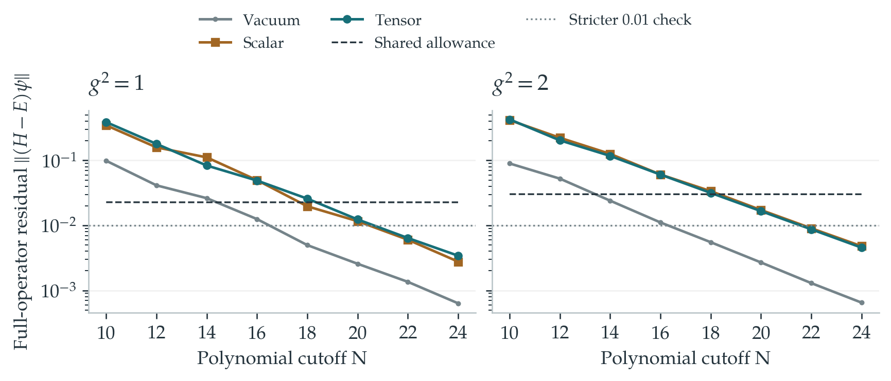

# Helike as a Probe of a Quantum Yang-Mills Model

**Updated 24 November 2026 | Geometric probes and verified sector refinement**

[Read the illustrated report (PDF)](report.pdf) · [Editable LaTeX](report.tex) ·
[Detailed numerical results](../../research/helike-quantum-probe-results-2026-11-23.md) ·
[Plan for using the evidence inside GIGI](../../research/ym-evidence-continuum-gigi-plan-2026-11-23.md)

## The result and its boundary

The working paper now includes the verified scalar/tensor refinement through
cutoff 24, with its mathematical construction on display. Both frozen controls
first meet the shared vacuum/scalar/tensor residual allowance at cutoff 20;
all three target states also meet the stronger fixed 0.01 check from cutoff 22.
At cutoff 24 the scalar residuals are 0.002774 and 0.004793, and the tensor
residuals are 0.003422 and 0.004552. These are full-operator residuals, including
the action outside the trial space and the finite eigensolver error.

The new sections derive the invariant-coordinate co-metric, exact rational
Gaussian moments, complete scalar polynomial space, two-generator tensor
module, residual decomposition, and potential factorization. Three new figures
show every residual, exact basis counts, and the two spectral branches. All
numbers and tables are generated from saved evidence, not copied by hand.



The contribution is the specific geometry-to-probe-to-sector construction and
its verified results. Related work is discussed explicitly: invariant-variable
and spin-resolved variational calculations already exist. This report makes no
unverified claim of worldwide priority or measured superiority to other solvers.

### Original survey, retained separately

A probe built from Helike's geometry was applied to a published SU(2) quantum
Yang-Mills matrix model, with its Hamiltonian unchanged. At the largest tested
basis and strongest coupling, 99.154% of the directional channel's finite-basis
excited response lies in the independently computed lowest level. At the other
two couplings, a separately defined scalar composite reaches the lowest level.

That survey's finite matrices were verified, but its convergence gates remained
open. The new sector run clears the target-state residual obstacle, not every
scientific gate: higher-spin competition, probe tails, high-cutoff state geometry,
certified separation and held-out crossing tests remain open. The old 99.154%
weight is still a cutoff-12 observation; the new run did not remeasure it.


## Reusable paper assets

Every figure has PDF, SVG and PNG versions. Use PDF for LaTeX inclusion and SVG
for vector editing. Asset 02 has a rasterized computed surface with vector text;
the other figures are vector plots. Captions, equations and methods are in
`report.tex`. The source contains no author line, and PDF author metadata is blank.

| Asset | What it shows | Files |
| --- | --- | --- |
| 01 | Original lowest-level response (paper Figure 2) | [PDF](figures/01-lowest-level-response.pdf), [SVG](figures/01-lowest-level-response.svg), [PNG](figures/01-lowest-level-response.png) |
| 02 | Exact quadratic signatures (paper Figure 3) | [PDF](figures/02-probe-geometry.pdf), [SVG](figures/02-probe-geometry.svg), [PNG](figures/02-probe-geometry.png) |
| 03 | Original full-level spectral weights (paper Figure 4) | [PDF](figures/03-spectral-response.pdf), [SVG](figures/03-spectral-response.svg), [PNG](figures/03-spectral-response.png) |
| 04 | Original cutoff/ordering history (paper Figure 5) | [PDF](figures/04-cutoff-history.pdf), [SVG](figures/04-cutoff-history.svg), [PNG](figures/04-cutoff-history.png) |
| 05 | Original residual and response-tail gates (paper Figure 6) | [PDF](figures/05-convergence-gates.pdf), [SVG](figures/05-convergence-gates.svg), [PNG](figures/05-convergence-gates.png) |
| 06 | New full-operator residual history (paper Figure 1) | [PDF](figures/06-sector-residuals.pdf), [SVG](figures/06-sector-residuals.svg), [PNG](figures/06-sector-residuals.png) |
| 07 | Exact basis counts, not a speedup benchmark (paper Figure 7) | [PDF](figures/07-sector-dimensions.pdf), [SVG](figures/07-sector-dimensions.svg), [PNG](figures/07-sector-dimensions.png) |
| 08 | New scalar/tensor branch estimates (paper Figure 8) | [PDF](figures/08-sector-energies.pdf), [SVG](figures/08-sector-energies.svg), [PNG](figures/08-sector-energies.png) |


Do not detach the 99.154% result from its cutoff and convergence qualification.
Do not identify H0 with the original linear eigenfield. Asset 02 is a visualization
of the declared tensors, not a numerical picture of the quantum vacuum.

## Evidence

- [New 16-case sector run](../../../research/sector-review-20261124/controls-abd81f97/), [receipt](../../../research/sector-review-20261124/controls-abd81f97/receipt.json), [verification](../../../research/sector-review-20261124/controls-abd81f97/verification.json)
- [Detailed new results](../../research/sector-review-results-2026-11-24.md), [registered protocol](../../research/sector-review-protocol-2026-11-24.md)
- [New plot data](sector-plot-data.json), [new case summaries](sector-summary.csv), [report-update gates](../../../research/paper-sector-update-20261124/)
- [Authoritative run and immutable source snapshot](../../../research/helike-quantum-probe-20261123/survey-20261124T021903Z-c326a3c5/)
- [Terminal receipt](../../../research/helike-quantum-probe-20261123/survey-20261124T021903Z-c326a3c5/receipt.json)
- [15-case evidence replay](../../../research/helike-quantum-probe-20261123/survey-20261124T021903Z-c326a3c5/verification.json)
- [Plot data](plot-data.json), [all case summaries](case-summary.csv), [complete spectral weights](level-weights.csv)
- [Artifact hash manifest](artifact-manifest.json), [report verification](report-verification.json)

The original experiment was run from base revision
`ed5d3cf5209bb8cecd6d97c4f0df3065af90363e` plus the exact implementation captured
in the receipt's per-file hashes and `source/` directory. Its later publishing
commit is not falsely presented as the revision originally executed. UTC receipt
dates are 24 November; the local research date is 23 November, Pacific time.

The new sector run used revision `abd81f978faf4b3c29fbc44d5ac6d7df02a75aae`.
All 16 cases, four 100-digit reassemblies and 36 matrix archives passed replay;
69 focused tests passed and 19 mechanism removals were rejected. The eigensolve
remained float64, including at 100-digit assembly precision. Runtime was
828.343 seconds and peak sampled worker memory 302,891,008 bytes. This was a
CPU-only run, not a GPU speedup benchmark. Replay verifies saved matrices;
it is not an independent fresh assembly of all physical operators.

## Reproduction

From the repository root, in the recorded Python environment:

```powershell
python scripts/verify_ym_helike_evidence.py research/helike-quantum-probe-20261123/survey-20261124T021903Z-c326a3c5 --run-id 20261124T021903Z-c326a3c5
python -m unittest discover -s scripts -p test_ym_helike_report.py
python scripts/build_ym_helike_report.py --pdf
python scripts/verify_ym_helike_report.py
```

The original evidence replay rebuilds matrices and checks stored results. For
the new sector run, saved-matrix replay is available separately:

```powershell
python scripts/run_ym_helike_sectors.py research/sector-review-20261124/controls-abd81f97 --verify
```

The report builder checks both receipts, source snapshots and matrix hashes, then
generates figures, tables and the PDF. It does **not** rerun the physical survey.
The report verifier checks hashes, runs the report tests and deliberate removal
checks, and confirms page count and empty author metadata. Visual inspection is
also required after a layout change. Running the interacting experiment anew
uses `python scripts/run_ym_helike_quantum.py` and creates a different run ID;
it does not silently replace this report's evidence.

Dependencies used: Python 3.12.10, NumPy 2.4.0, SciPy 1.16.3,
Matplotlib 3.10.8, PyMuPDF 1.27.2.2, SymPy 1.14.0, psutil 7.2.2,
threadpoolctl 3.6.0; the survey used PyTorch
2.11.0.dev20260108+cu128 on the RTX 5070 Laptop GPU. Report-only work does not
need CUDA; evidence replay requires the scientific Python dependencies.
PDF generation requires LaTeX with `newpxtext`, `newpxmath`, `microtype`,
`caption`, `fancyhdr`, `enumitem`, `hyperref`, `booktabs` and `geometry`.
The text/math font settings match `../dgstyle.tex`; plot fonts use the same
Palatino/Pagella family, loaded from TeX Gyre Pagella via `kpsewhich`.

The GIGI integration remains a plan, not a deployed feature. Its first milestone
is an exact live-engine round-trip of both evidence families, with their scopes
kept separate. Building this report does not execute a new physical experiment.
