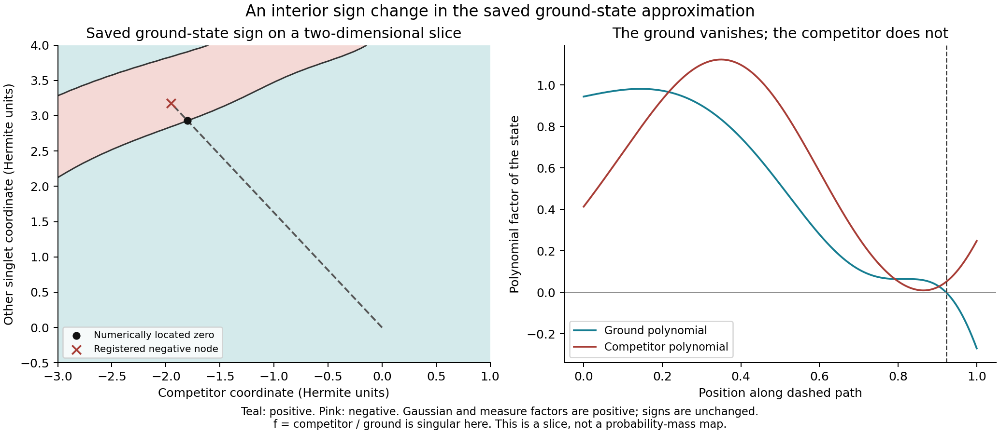

# Ground-weighted carrier geometry: the saved ground crosses zero

**COMPUTED. The registered geometric probe is OPEN, not passing. The original export gate remains
FAIL and the full grid remains held.** No eigenstate, model, physical metric, acceptance threshold,
or reference score was changed. This note records a specific obstruction, not a successful repair.

## What was tried

The [registration](helike-carrier-geometry-probe-registration-2026-11-26.md) asks whether the
competitor retains its geometric energy direction after the ground state changes shape. Instead of
judging only its overlap with a fixed oscillator reference, the existing M8 construction reads the
gradient of the competitor divided by the ground state, in the physical metric and ground-state
measure. Its inexact-ground residual term is retained.

The input is the already saved Mq 12 point at s=1.18, t=3, g^2=0.03. The old reference score is
0.9128515410191, below the unchanged 0.95 requirement. The dressed projection, 0.9740076181555388,
is not a replacement for that requirement. No new eigensolve was performed.

The first prerequisite is positivity of the saved ground where the registered per-node vacuum
weight exceeds 1e-12 of the global norm. This check failed at both fixed orders, 14 and 16. The run
therefore stopped before computing gradient-energy shares or an M8 energy-identity result.

## Measured obstruction

| Quantity | Order 14 | Order 16 |
| --- | ---: | ---: |
| Negative ground nodes above the registered floor | 22,020 | 25,620 |
| Sum of their vacuum quadrature weights | 1.0134263077309613e-7 | 9.48058593227918e-8 |
| Largest negative-node vacuum weight | 8.614598117174807e-11 | 5.4637572423079566e-11 |
| Integrated ground norm | 0.999999999999488 | 0.9999999999989726 |
| Integrated competitor norm | 0.9999999999995265 | 0.9999999999989789 |

These are discrete quadrature measurements, not a certified continuous negative-region mass.
The affected total weight is small. Nevertheless, individual negative nodes exceed the registered
floor by approximately 86 and 55 times, respectively. Good normalization does not guarantee
pointwise positivity. A global phase was fixed once; no pointwise absolute value was taken.

The full preflight took 3.906 seconds, with both grids evaluated in slabs using the global norm.
Slabbing changes memory use, not the nodes, quadrature rule, physical coordinates, or cutoff.

## Independent geometric check

After the refusal, a separate diagnostic evaluated the saved coefficients by direct products of
SciPy Hermite polynomials, rather than the probe's recurrence and tensor contractions. It reproduced
the two negative-node polynomial values to absolute differences of 1.33e-15 and 5.00e-16.
This is an independent evaluator of the same saved representation, not an independent ground-state solve.

On a two-dimensional slice varying the competitor coordinate and the other singlet coordinate,
the ground polynomial changes sign along a path entirely within the log-Cholesky physical chart.
A bracket at path parameters 0.921875 and 0.9375 gives values +0.0007312003267095769 and
-0.033010640411541725. Brent root finding locates a zero at parameter 0.9222657186527894:

- Ground polynomial at the numerical root: -1.0617591875150545e-15.
- Competitor polynomial there: 0.050926418884193005.
- Smallest physical Gram-matrix eigenvalue there: 46.61194487695084.
- Smallest pulled-back metric eigenvalue there: 0.2998902759475348.

The Gaussian and measure factors multiplying these polynomials are positive. They cannot remove
the sign change or make the competitor vanish at the same point. The witness is inside the physical
cone, not on its degenerate boundary. This is floating-point root localization, not interval certification.



Left: teal is positive and pink is negative for the saved ground approximation; the black contours
are its computed zero set on this slice. Right: along the dashed path, the ground crosses zero while
the competitor does not. This is a sign diagram, not a probability-mass map. Vector output is available
in [the figure PDF](../../research/carrier-geometry-20261126/nodal-geometry.pdf).

In plain English: the proposed geometric reading divides by the saved ground. That denominator
crosses zero inside the allowed region, while the numerator stays nonzero. The ratio is singular
there. Making the denominator positive by clipping it or taking its absolute value would change
the state and is not an accepted repair.

## What this does and does not establish

The test establishes why this saved approximation cannot be used as the everywhere-positive
denominator required by the registered M8 diagnostic at this point. It does not establish that the
exact physical ground has a zero. It also does not establish that the small negative-weight region
caused the original reference-score shortfall. No physical energy-direction share was produced,
so this run does not decide between shape deformation and genuine carrier mixing.

The planted control does establish a separate mathematical possibility: an exact width-deformed
first excitation has old rescaled overlap 8/9 while retaining ground-weighted alignment 1 and its
entire gradient energy in the intended channel. A second, genuinely mixed control remains mixed.
Those controls validate the distinction being tested; they are not a substitute for the real result.

## Test-first evidence

- The new harness first failed its four missing-mechanism checks; the initial RED log is retained.
- An additional nonfinite coarse-share test exposed a false-acceptance path before its correction.
- All 7 new focused checks pass, including slab/full-grid values and all six derivatives,
  global-cut partition invariance, source-hash refusal, and prevention of stale output reuse.
- All 9 existing M8 geometry tests pass. No full repository suite was run or claimed.
- Deliberately removing a derivative, the ground weighting, or global cut normalization breaks
  assertions. All three mechanism-removal checks were caught, with no test-runner errors.
- The real acceptance result remains OPEN. Passing the harness does not close the research gate.

The final independent diagnostic completed successfully. An initial plotting-script syntax error
and the corrected rerun logs are both retained; that script is diagnostic, not an acceptance gate.

## Reproduction and provenance

Base revision: `d3e03ad13d99755f9559900e2ec6d6e48ff795c1`, with uncommitted local probe changes.
The run receipt records the exact kernel hashes; this is not a claim that the clean base revision
alone contains the probe. Python 3.12.10, NumPy 2.4.0, SciPy 1.16.3; four OpenBLAS threads.

Source LF-normalized SHA-256:
`15ed4b72a41ab4f1125fbe3a3bb3b6f35775c0ef077f1fc3f8b8f1a8b3969833`.
Parent receipt SHA-256:
`b790b53f6186b6d3b1767c91cc1f087486d2db98c2bd291fce14db40524210a6`.
Probe receipt SHA-256:
`9b01976060cb9caf4fe6a22be6409b6d4c645fa5e08d7f52906191dd02f5b774`.

Run from the worktree root in PowerShell. Use a new output directory for each real probe:

```powershell
$env:OPENBLAS_NUM_THREADS='4'
python -m unittest discover -s scripts -p test_helike_carrier_geometry_probe.py -v
python scripts/check_helike_carrier_geometry_mutations.py research/carrier-geometry-replay-tests/mutations
python -u scripts/helike_carrier_geometry_probe.py research/carrier-geometry-replay
# Expected exit code 2: the registered positivity refusal, not a successful gate.
python scripts/check_helike_ground_nodal_geometry.py research/carrier-geometry-replay
```

Evidence: [probe receipt](../../research/carrier-geometry-20261126/receipt.json),
[slab progress](../../research/carrier-geometry-20261126/events.jsonl),
[independent zero check](../../research/carrier-geometry-20261126/nodal-check.json),
[focused checks and RED logs](../../research/carrier-geometry-20261126-tests/), and
[mechanism-removal receipt](../../research/carrier-geometry-20261126-tests/mutations/receipt.json).

## The next mathematical question

Can a ground-state representation that stays positive by construction match the same operator,
physical measure, energy and residual requirements, so the ratio geometry is defined? That requires
a separately registered construction, not another cutoff choice. An exponential amplitude is one
candidate, but its integrability, boundary behavior and residual evaluation must be established;
positivity alone is insufficient. No such construction was implemented or run here, and it is not
known to repair the unchanged 0.95 reference requirement.

The bounded experiment ends here. The full grid remains held.
