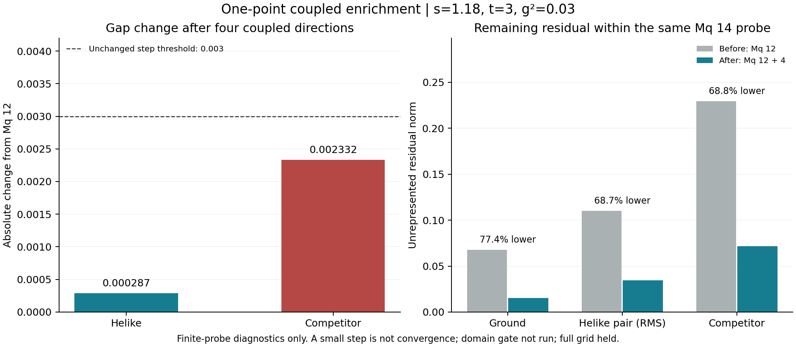

# Four coupled directions reduce the measured residual

**COMPUTED: one-point finite-probe improvement. Overall UNRESOLVED; full grid held.**

The [frozen enrichment experiment](helike-coupled-enrichment-registration-2026-11-26.md) completed at
s=1.18, t=3, g^2=0.03. Adding four directions to the entire 18,564-dimensional Mq 12 space reduced the
competitor's unrepresented residual within the Mq 14 probe by **68.8%**. The Helike pair improved by
**68.7%** and the ground state by **77.4%**. Both new gap changes are below the unchanged 0.003 step threshold.

This is a useful improvement, not closure of the original gate. The competitor's reference weight w/Z
remains below the necessary 0.95 export threshold, the domain gate was not run, and a single small step
does not establish convergence. No larger grid or second enrichment was launched.



## What changed, and what did not

The previous diagnostic located the missing support in coupled occupations. Only about 5.34% of the
competitor's omitted squared residual lay on the pure competitor axis. This experiment therefore used
the measured coupled residuals, not four hand-picked single-axis basis functions.

For the old ground state, two Helike partners, and competitor, form the four columns

    R_j = (I - P_12) (H_14 - E_j) psi_j.

Here H_14 is the unchanged operator projected into the Mq 14 basis, and P_12 projects onto the retained
Mq 12 space. Whiten the full-rank Gram matrix R^T R to obtain four orthonormal columns U, supported
outside the old space. The new trial space is W = V_12 plus span(U), of dimension **18,568**.

The lift J(x,y) embeds every old coefficient x and adds U y. The implemented matrix-free action is

    J^T H_14 J = [ H_12    C ]
                 [ C^T     D ],
    C = P_12 H_14 U,  D = U^T H_14 U.

Both couplings are necessary. In particular, omitting C^T would not be this self-adjoint projected
operator. The four added vectors may mix many occupations; four directions does not mean four raw
occupation cells. No old basis function was removed, and no selected-state-only replacement was used.

The Hamiltonian, chart, physical point, reference identification, solver tolerance, and existing gate
thresholds were unchanged. The 38,760-dimensional Mq 14 space supplied operator actions and a residual
probe only. Its full eigenproblem was not solved. The four added directions increased the trial-space
dimension by approximately 0.0215%; this does not by itself establish a runtime advantage.

## Measured results

| Quantity | Original Mq 12 | Mq 12 plus four directions | Absolute change |
| --- | ---: | ---: | ---: |
| Ground energy | 5.420012553018869 | 5.419829569928328 | 0.000182983090541 |
| Helike gap | 1.056067239651605 | 1.055780215462446 | 0.000287024189159 |
| Competitor gap | 1.090392323397661 | 1.088060108040722 | 0.002332215356939 |

Both gap steps pass the numerical comparison <= 0.003 for this new experiment. This is not a
retroactive pass of the old Mq 6/8/10 ladder, nor a convergence proof for either gap. Gap differences
subtract the newly computed ground energy; they are not just shifts of the excited energy levels.

The following compares the unrepresented residual in the **same Mq 14 ambient probe**, before and
after enrichment. The omitted subspace changes from the complement of V_12 to the complement of W.
The in-trial-space residuals are negligible at the displayed scale, so these also agree with the
corresponding total ambient residual norms to the shown precision.

| State | Before | After | Reduction in norm |
| --- | ---: | ---: | ---: |
| Ground | 0.06760661248 | 0.01524989697 | 77.44% |
| Helike partner A | 0.10269016076 | 0.03166215303 | 69.17% |
| Helike partner B | 0.11669745963 | 0.03697999281 | 68.31% |
| Helike pair, RMS | 0.10991716472 | 0.03442391467 | 68.68% |
| Competitor | 0.22934194456 | 0.07164588112 | 68.76% |

These are residual-norm reductions, not percentages of energy error, probabilities of correctness,
or full-operator bounds. The residual beyond Mq 14 remains unmeasured by this experiment.

### The states remained closely aligned

- Ground: squared overlap with the old state, 0.9999894859003481.
- Competitor: squared overlap, 0.9997925162339276.
- Helike pair: singular values of the old/new two-dimensional overlap matrix,
  0.9999849877891486 and 0.9999755738033681.

The pair comparison does not depend on choosing an orientation inside a nearly degenerate doublet.
These overlaps support continuity of the tracked states in this experiment; matching eigenvalue
positions alone would not have supplied that check. Full coefficient bit patterns, shell probabilities,
and joint occupation summaries are retained for independent inspection.

### The unresolved identification condition is separate

| Reference weight w/Z | Before | After | Grid >= 0.9 | Necessary export >= 0.95 |
| --- | ---: | ---: | --- | --- |
| Helike | 0.96538837105 | 0.96545603183 | PASS | PASS |
| Competitor | 0.91285154102 | 0.91227140823 | PASS | FAIL |

The competitor's weight decreased slightly even though its residual improved substantially. Its
report-only dressed overlap is 0.9733075405742866, but that is a different statistic and cannot replace
w/Z. A deliberately corrupted export making that substitution was rejected.

The necessary weight check is not the domain certificate. The degree-10 rigorous cutoff cap is
unchanged; this enriched representation has support through degree 14. No domain-validity result
was manufactured from the finite-space solve. `domain_gate=NOT_RUN`, `certified=false`, and
`full_grid_released=false` remain explicit.

## Verification and execution

- Seven focused Rust tests pass, including analytic block arithmetic, isometry, rotation-invariant
  residual span, refusals, and direct operator comparisons on both weak-coupling controls.
- Six focused Python tests pass, covering independent geometry recovery, negative evidence,
  unchanged contracts, changed-input refusal, output-directory reuse, separation of gates, and
  replacement of a stale audit PASS with STOPPED when replay fails. The last test first demonstrated
  the stale-report defect and then passed after a reporting-only fix; no physical rerun was needed.
- All four compiled mechanism-removal variants fail their tests: omitted C, omitted C^T,
  omitted whitening, and omitted ambient projection. The unmodified baseline passes.
- The saved live export replays independently. All eight corruptions are rejected: false release,
  loosened solver tolerance, erased complement, zero direction, zero state, changed retained identity,
  forged gap, and substituted dressed overlap.
- Fresh operator actions reproduced the four saved input residuals with zero measured difference.
- Three block/direct projection comparisons had maximum relative discrepancy 2.161382480624623e-15.
- All 12 Ritz residuals satisfy 1e-10 * max(1, abs(E)). Their maximum was 2.683510623461669e-10;
  this is a scaled tolerance, not an absolute 1e-10 requirement.
- The four selected states' residuals projected back into W were between 7.02e-14 and 9.77e-14.
  Independent reconstruction verifies their inside/complement split and squared-norm identity.
- Ordered energies satisfy the registered nested variational sanity check. Gaps need not be monotone.

Red logs precede implementation; the initial Rust literal syntax error is retained separately and
is not counted as a behavioral failure. Only focused tests were run, not the full repository suite.

The solve used the existing CPU exact-moment operator and block Lanczos, eight threads, 12 levels,
block size 4, tolerance 1e-10, and maximum Krylov dimension 1600. It used 652 operator applications
in the eigensolver and Krylov dimension 640. Native elapsed time was 377.731 seconds; the wrapper
recorded 378.723 seconds before printing its detailed analysis. This run does not benchmark a speedup.

## Evidence and reproduction

- [Aggregate receipt](../../research/coupled-enrichment-20261126/receipt.json)
- [Native receipt](../../research/coupled-enrichment-20261126/native-receipt.json)
- [Prepared directions, state bits, and residual bits](../../research/coupled-enrichment-20261126/enriched.json)
- [Focused tests and red/green logs](../../research/coupled-enrichment-20261126-tests/)
- [Compiled mechanism-removal results](../../research/coupled-enrichment-20261126-tests/mutations/mutation-results.json)
- [Actual-export corruption checks](../../research/coupled-enrichment-20261126-tests/evidence-mutations.json)
- [Figure PDF](../../research/coupled-enrichment-20261126/enrichment.pdf)

Source base: `d3e03ad13d99755f9559900e2ec6d6e48ff795c1`, with the new local changes explicitly recorded
as dirty, not misrepresented as a clean release. Native source LF digest:
`aa79950f94cf8eacfe06f2d14e7cb241efffb6044e2d70bd8cb0b5864b2c6215`.

Binary SHA256: `ae94cbc46b76d4894997306d47497af48f0b65acf7ce1d8ac3f84667ded9a090`.
Export LF SHA256: `f4445e2010a264ceb555c9381eece0d03f0266af0162088fe603c0f9ac37c23f`.
Aggregate receipt LF SHA256: `0e557b090f3e285204b743aeebc87d8f521b7004d862ce04177daf25db9aee0d`.
The registration and receipts pin both parent input hashes.

From the worktree root, the focused gates and replay are:

```powershell
$env:RAYON_NUM_THREADS='8'
cargo test --release --manifest-path helike-lab/Cargo.toml -p helike-quantum --test coupled_enrichment
python -m unittest discover -s scripts -p test_helike_coupled_enrichment.py -v
python scripts/check_helike_enrichment_mutations.py research/coupled-enrichment-20261126-tests/mutations
python scripts/check_helike_enrichment_evidence.py research/coupled-enrichment-20261126 research/coupled-enrichment-20261126-tests/evidence-mutations.json
python scripts/plot_helike_coupled_enrichment.py research/coupled-enrichment-20261126
```

To reproduce the physical diagnostic, rebuild `helike` in `helike-lab` and run
`python scripts/run_helike_coupled_enrichment.py <new-output-directory>` from the worktree root.
It refuses an existing output directory or changed pinned inputs. The native CLI command, input
hashes, binary hash, source provenance, stdout, and stderr are preserved with the actual run.

## What this establishes

The earlier geometric diagnosis was operationally useful: giving the solver four measured coupled
directions substantially reduced the same finite-probe obstruction while retaining the original
trial space and tracking closely aligned states. The improvement is observable in the residual,
not only in an apparently stable energy.

What remains is specific: a nonzero residual outside W, unmeasured support beyond Mq 14, the competitor
w/Z export condition, and the absent domain certificate. The registered stopping point is reached.
No automatic second enrichment, full Mq 14 eigensolve, or grid release follows from this result.
