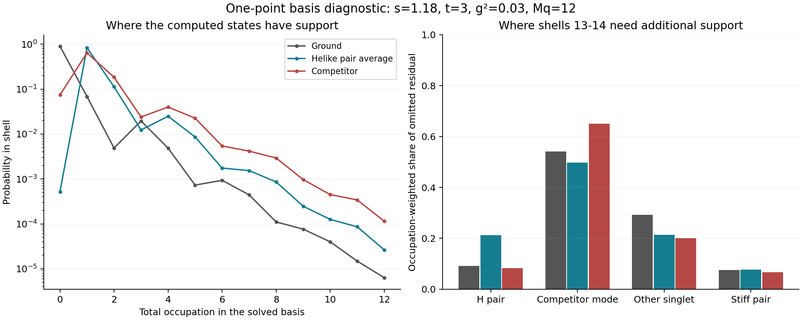

# The competitor needs coupled room

**COMPUTED diagnostic. The gap gate remains UNRESOLVED. Full grid held.**

Registration: [bounded support diagnostic](helike-flux-support-registration-2026-11-26.md).
Evidence: [receipt](../../research/flux-support-20261126/receipt.json),
[bit-preserving state export](../../research/flux-support-20261126/support.json),
[native receipt](../../research/flux-support-20261126/native-receipt.json).

## What I measured

I repeated the same point, s=1.18, t=3, g^2=0.03, Mq=12. The selected gaps reproduce the preceding smoke result:
Helike 1.0560672396516049, competitor 1.0903923233976611. All twelve levels reproduce within the registered
1e-8 replay tolerance; the identification weights also reproduce. No model, coordinate, source, numerical
tolerance or acceptance threshold changed.

This time I retained the coefficients. I embedded the ground state, both reference-selected Helike partners,
and the competitor into the Mq=14 space and applied the same operator. I did not solve the Mq=14 eigenproblem.
The extra rows measure the operator's action into the first two omitted shells.



Left: probability by total occupation within the solved Mq=12 space. Right: occupation-weighted group shares
of the squared residual in shells 13 and 14. These are chart-basis quantities. The right panel normalizes
each distribution separately; its bar heights do not show absolute residual magnitudes. Those are below.
The Helike distribution is the average of both partners' squared coefficients, not a choice of one orientation.

## The measured obstruction

| State | Residual inside V_12, measured through H_14 | Residual in shells 13 and 14 |
| --- | ---: | ---: |
| Ground | 5.41e-14 | 0.06760661248 |
| Helike partner A | 6.57e-14 | 0.10269016076 |
| Helike partner B | 5.88e-14 | 0.11669745963 |
| Helike pair, root-mean-square norm | -- | 0.10991716472 |
| Competitor | 8.66e-14 | **0.22934194456** |

The competitor has about **2.0865 times** the Helike pair's RMS omitted-shell residual norm. The nested-block
action agrees with the original operator: the largest norm discrepancy is 4.41e-14. The finite-space solve
is accurate, but its agreement inside the trial space does not remove the action pointing outside it.

The competitor's probability in shells 11 and 12 is only about 0.000455918, or 0.0456%. That small probability
does not imply that dropping the operator's coupling to additional functions is harmless.

These are projected residual norms, not bounds on the full residual or error bars on a physical gap. Shells
above 14 have not been examined. The physical-domain certificate was not attempted, and its degree-10 cap
was not changed.

## The shape is coupled, not one straight direction

The registered occupation-weighted allocation of the competitor's omitted residual is:

| Harmonic-chart mode group | Share |
| --- | ---: |
| Competitor mode | 64.9474% |
| Other singlet | 20.1336% |
| Helike pair | 8.2345% |
| Stiff pair | 6.6844% |

These shares allocate each joint coefficient according to its occupation counts. They are not independent
causal contributions, physical spatial directions, or fractions of a certified spectral error.

The largest joint bins, in the order (Helike-pair occupation, competitor occupation, other-singlet occupation,
stiff-pair occupation), include:

- (0,11,0,2): squared residual mass 0.0033459122174.
- (0,9,4,0): 0.0027549012052.
- (0,11,2,0): 0.0025118017965.
- (0,13,0,0): 0.0022971256147.
- (0,7,6,0): 0.0020766101082.

The following are explicitly **post-diagnostic exploratory summaries**, not preregistered acceptance gates:

- Pure competitor-axis functions carry only **5.3417%** of the measured omitted residual mass.
- Functions with competitor occupation at least seven carry **82.3809%**, but most of that support is coupled
  to other modes.
- The largest joint bin carries **6.3613%**; the ten largest together carry **41.4112%**.

So a pure-axis extension would miss most of what was measured. The residual is biased toward high competitor
occupation, but is not concentrated in one coordinate basis function or a handful of isolated joint bins.

## A justified next construction, not yet a repair

Instead of choosing an occupation cutoff from those percentages, I can let the measured operator action
define the added directions. Write the four omitted residual columns as

\[
R=\bigl[(P_{14}-P_{12})H\psi_0,\,
        (P_{14}-P_{12})H\psi_{H,a},\,
        (P_{14}-P_{12})H\psi_{H,b},\,
        (P_{14}-P_{12})H\psi_C\bigr].
\]

An SVD on the omitted rows gives four independent directions. The measured singular values are approximately
0.23790971715, 0.11656024702, 0.10269016076 and 0.02448170681. Their orthonormality error is 7.78e-16, and they
reconstruct these four projected residuals to at most 1.31e-16 in norm. They are combinations of many basis
functions, not four newly discovered coordinate functions. Four vectors spanning four residuals is elementary
linear algebra; by itself it is not a convergence result.

If U contains those orthonormal omitted-row directions, a proposed nested space is

\[
W=V_{12}\oplus\operatorname{span}(U),\qquad
\dim W=18{,}568,\quad \dim V_{14}=38{,}760.
\]

It retains the entire old trial space. It does not replace it with a small subspace of selected eigenvectors.
In this basis the proposed projected operator has the block form

\[
H_W=
\begin{pmatrix}
H_{12}&C\\
C^\mathsf{T}&D
\end{pmatrix},
\qquad C=P_{12}H_{14}U,\qquad D=U^\mathsf{T}H_{14}U.
\]

This provides a concrete next test: keep the existing operator, add the coupled directions the residual
actually identifies, and check the resulting energies, state geometry and further omitted residuals. It is
related to standard residual-driven subspace expansion, not a claim of a new eigensolver. SLEPc describes
Davidson-type methods that expand a search space using residual-derived corrections in its
[eigensolver manual](https://slepc.upv.es/release/documentation/manual/eps.html); see also its
[technical report on subspace expansions](https://slepc.upv.es/documentation/reports/str10.pdf).
The proposal here is an unpreconditioned finite-basis enrichment, not a full Davidson implementation.

**Not done:** no enriched eigenproblem was solved. Capturing the current residual does not prove that a
recomputed state will have a small new residual, that higher shells are controlled, or that the competitor
will pass w/Z >= 0.95. Smaller trial dimension is not a demonstrated runtime advantage.

Before a numerical enrichment run I would freeze the construction, rank policy and verification ladder in a
separate registration. Focused tests must verify the isometric embedding, nested-space identity, block adjoint,
pair-rotation behavior, and reproduction of the unchanged operator. The old failed grid cannot be relabeled
using an unregistered basis family. Its gap, identification and domain requirements remain separate.

## Gates and independent checks

- Eight focused Rust tests pass, including both weak-control nested-operator actions.
- Four independently implemented Python summary tests pass.
- Four compiled mechanism removals are caught: no squaring, positional embedding, erased outer residual,
  and missing mass normalization. The unmodified generated test crate passes.
- Six corruptions of the real export are rejected: wrong point, false certificate, wrong summary, substituted
  coefficients, missing shell entry, and wrong energy.
- All reported distributions and norms were independently recomputed in Python from the native binary64
  bit patterns. The image was inspected for legibility. No full repository suite was run.

Receipts and logs: [focused evidence](../../research/flux-support-20261126-tests/README.md).
Exploratory recounts and SVD: [analysis JSON](../../research/flux-support-20261126/exploratory-analysis.json).

## Provenance and reproduction

The diagnostic completed in 334.49 seconds, using eight CPU threads and no GPU. Source base:
`d3e03ad13d99755f9559900e2ec6d6e48ff795c1`, with the new diagnostic code uncommitted. The receipt accurately
reports a dirty source tree; this is not an assertion that the base commit contains the new command.

- Solver source digest (LF policy): `8826771bd0ad6aa9dfbafa86762d4a04aa46dbe13b61cbb57471e1f5a00a2c6e`.
- Executable SHA256: `2dced8786858ad3d74688be80505bb69d5b8bbc74c750ba229ebd398991dabe9`.
- Harness LF digest: `1b515ad544cecbbff182c625696d195ca20a63fc0d9b3b9403ef375a0ae8cea4`.
- Aggregate receipt LF digest: `b790b53f6186b6d3b1767c91cc1f087486d2db98c2bd291fce14db40524210a6`.

From the repository root, with the new source present:

```powershell
cargo build --release --manifest-path helike-lab/Cargo.toml --bin helike
python scripts/run_helike_flux_support.py research/flux-support-NEW-RUN
python scripts/check_helike_flux_support_evidence.py research/flux-support-NEW-RUN
```

The first command after building performs the one-point solve and refuses an existing output directory.
The evidence checker only reads saved data; it performs no new physical eigensolve.
