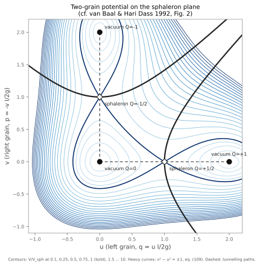

# Two grains, Phase 2: sphalerons, barriers and the Fig. 2 check

24 November 2026. **COMPUTED (closed forms; finite-difference Hessians that match the exact spectra within test tolerance). No quantum Hamiltonian spectra.** Phase 2 of the
[two-grain scope](helike-two-grain-scope-2026-11-24.md), following [Phase 1](helike-two-grain-phase1-2026-11-24.md).
Code: `scripts/ym_two_grain_potential.py`. Tests: `scripts/test_ym_two_grain_potential.py` (your 15 plus 3 Phase 2 tests, 18 passing).
Mutation check: 7 of 7 caught by assertion.

## The sphaleron plane

Van Baal and Hari Dass, eq. (88), use the plane c = −uδ, d = −vδ. In my variables this is q = u I/(2g),
p = −v I/(2g). The plane is the fixed set of the combined colour-and-space rotations, so by symmetric criticality
every critical point of V₁₈ restricted to it is a critical point of the full eighteen-mode potential. Each one
is then classified by its full 18 × 18 Hessian.

Restricted to the plane, Phase 1's potential becomes, exactly,

  32π²g² V₁₈ = 3π²[u²(2 − u)² + v²(2 − v)²] + 4π²u²v².

**This is their potential, normalization included.**
- Along the tunnelling path, their eq. (54) at ε = 0 gives 3π²(1 − a²)² with a = u − 1. That is the first term.
- Their eq. (92) cross term is (2π²/3){(cᵢᵃ)²(dⱼᵇ)² − (cᵢᵃdⱼᵃ)²} = (2π²/3)(9 − 3)u²v² = 4π²u²v². That is the second.

So their coefficients and mine agree, related by the single constant 32π²g², which absorbs their radius, volume and
Hamiltonian conventions. This completes the normalization comparison that Phase 1 left open. My potential was
derived independently, from the Lie algebra and an exact icosahedral quadrature, before I read their equations.

## Critical points

A Newton search from a 19 × 19 grid finds five critical points in the plane. That is a search, not an exhaustion
proof for the saddles; the vacua are exhausted by the nonnegativity argument in Phase 1.

| (u, v) | V / V_sph | Chern–Simons Q | 18-mode Hessian |
| --- | --- | --- | --- |
| (0, 0) | 0 | 0 | all eighteen eigenvalues 1 |
| (2, 0) | 0 | +1 | stable; 3 orbit zero modes |
| (0, 2) | 0 | −1 | stable; 3 orbit zero modes |
| (1, 0) | 1 | +½ | **index 1**: −½ (×1), 0 (×3), 4/3 (×9), 5/2 (×5) |
| (0, 1) | 1 | −½ | the mirror of (1, 0) |

V_sph = 3/(32g²) in model units (3π² in theirs). Q = 2g²(W_L − W_R) is normalised so that the left vacuum has
Q = 1.
- **Chern–Simons values.** Integer at the vacua and half-integer at the sphalerons, as they state (p. 212). Q
  vanishes identically on the line u = v (p. 213). That line is where the two grains cancel.
- **The sphalerons are mountain passes in all eighteen modes**, not only in the plane: exactly one unstable
  direction, with curvature −½ independent of g. The other grain's nine modes are stiffened from 1 to 4/3 by the
  cross term, as computed analytically from (g²/3)(T_qT_p − tr(qqᵀppᵀ)) at qqᵀ = I/(4g²).
- **Barriers.** Each vacuum-to-vacuum route through a sphaleron costs V_sph = 3/(32g²). The search found no other
  saddle in the plane, so within the plane the left and right vacua appear to connect only through the origin,
  crossing two barriers. Routes leaving the plane are not excluded.

## The Fig. 2 check

This is my reproduction of their Fig. 2 from the Phase 1 potential. Contours are V/V_sph at 0.1, 0.25, 0.5, 0.75
and 1 (bold), then 1.5 to 10. The heavy curves are the boundary curves of their eq. (109),
‖d‖² − ‖c‖² = 3(−1)ⁱπ², which with ‖c‖² = 3π²u² become v² − u² = ±1. Dashed lines are the tunnelling paths.
Compared feature by feature with the published figure (a visual comparison, not a digitised overlay):
- the same three basins, with the narrow valleys to (2,0) and (0,2);
- saddles at (1,0) and (0,1), where the separatrix contour crosses;
- the boundary curves: one with its vertex at the (0,1) sphaleron, opening upward, and one through (1,0), each
  crossing the tunnelling path at a right angle at the sphaleron, as their footnote describes;
- the steep rise away from the paths and toward negative u and v, which they remark on ("very steep rise of the
  potential in the direction perpendicular to the sphaleron paths").

I have not embedded or redrawn their figure; the comparison is against the published page.

## What Phase 2 settles, and what it does not

**Settles.** The eighteen-mode potential I derived is van Baal and Hari Dass's: the same vacua, sphalerons,
Chern–Simons values and normalization. The geometry along the paths that their θ-dependence analysis uses is
reproduced exactly. The second vacuum's local harmonic offset (1 with one grain, about 3.37 with two) remains a
truncation-dependent local estimate, not a global spectral gap. They treat the vacua through boundary
identifications on the fundamental modular domain, not through local Hessians.

**Does not settle.**
- No spectra: whether the one-grain scalar–tensor crossing survives both grains is a Phase 3 question.
- Off-plane saddles were not searched.
- Their boundary conditions (eqs. (96)–(108)) are not implemented. A two-grain spectrum that ignores them is a
  statement about the truncated Hamiltonian, not about θ-vacua.

## Next: Phase 3

Before building, budget the (0,0) sector:
- Count its invariants with a verified Molien series. The rational-point rank is only a lower bound, as the revised
  scope says.
- Decide whether to implement the boundary identifications or to state the free-boundary scope explicitly.
- Choose matched comparisons against the one-grain results at equal cutoffs.
