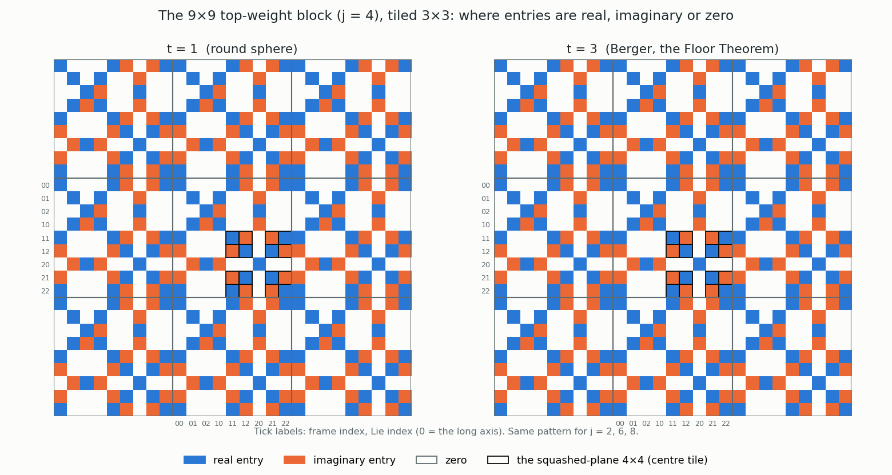

# Test 2, family 1: the squashed meron is class N (20 November 2026)

Protocol: [`skeleton-tests-preregistration-2026-11-20.md`](skeleton-tests-preregistration-2026-11-20.md) §4,
"Protocol for family 1", committed in 5063d460 before this script existed. Script `scripts/ricci_su2_test2_family.py`.
Receipts: `research/su2-floor-family-20261119/test2_berger_control.json` and `test2_meron.json`. Status: **Numerical**
(double precision).

## Code control: passes

On the Berger family (the Levi-Civita field of (t, 1, 1)) the script gives T_all = {2.70, 2.75, …, 10.00}, exactly
the required set, so the class is P. The per-sector onsets are listed below; j = 4 is the last sector to become the
floor, as required.

| j | 0 | 1 | 2 | 3 | 4 | 5 | 6 | 7 | 8 | 9 | 10 | 11 | 12 |
|---|---|---|---|---|---|---|---|---|---|---|---|---|---|
| floor from t = | 2.25 | 2.55 | 2.45 | 2.50 | 2.70 | 2.65 | 2.60 | 2.55 | 2.50 | 2.45 | 2.40 | 2.40 | 2.35 |

## Family 1, the squashed meron: class N

- **The extremal state is the floor at no grid point, in no sector.** T_all is empty, and so is every per-sector
  set.
- **Checks held everywhere.** At all 2,600 (t, j) pairs the extremal state was an exact eigenvector of H and
  gauge-orthogonal:
  - residual ≤ 4.7 × 10⁻¹²;
  - ‖G*b‖ ≤ 8.5 × 10⁻¹⁵.

  This is as the counting argument requires, which confirms the meron's circle invariance numerically.
- **Consistency at t = 1.** There the meron is the Berger field, and the extremal values 10, 17, 26 for j = 0, 1, 2
  equal the floor law λ₁(j) = j² + 6j + 10. They also appear in the published meron spectrum (−2, 1, 6, 7, 10 in
  spins 0 to 2).

**Verdict by the pre-registered rule.** Any independent tested family classified N counts against the scoped
hypothesis. This one is N. So the scoped hypothesis is **counted against**:

> In every independent circle-invariant family, the unique maximal-charge state is the floor of every listed sector
> on a parameter range of positive length.

## What this does and does not touch

- **Untouched.** Everything certified about the Berger field:
  - the Floor Theorem at t = 3 and t = 4;
  - the floor law on [2.75, 10];
  - the Landau structure of the twist, now proved.

  Those are statements about one background, and they stand.
- **What falls.** The reading that the extremal mode is the floor *because of the circle symmetry*, in any
  circle-invariant setting. On the resting field of the same family of shapes, with the same symmetry, the extremal
  state is never the floor.
- **What the floor property depends on, then.** It is something about the Berger field beyond its symmetry. One
  candidate is that the Berger field is not at rest. That is not tested here.

## Exploratory (not pre-registered, no gate)

Where the extremal state sits in the gauge-orthogonal spectrum of the squashed meron:

| t | j = 0 | j = 2 | j = 4 | j = 8 | j = 12 |
|---|---|---|---|---|---|
| 0.5 | top (the doubled highest value) | top | top | top | top |
| 1.0 | top | top | top | top | top |
| 3.0 | 2nd of 6 | 8th of 18 | 11th of 30 | 11th of 54 | 9th of 78 |
| 10.0 | 2nd of 6 | 7th of 18 | 6th of 30 | 5th of 54 | 5th of 78 |

Rank counts the eigenvalues strictly below the extremal value, plus one. "Top" means the extremal value is the
largest eigenvalue of the sector. At t = 1 it is shared with other states, because the round sphere's larger
symmetry adds degeneracy.

- For t ≤ 1 the extremal state is the **ceiling** of every sector.
- As the sphere stretches, it descends through the spectrum but does not reach the floor by t = 10.
- On the Berger field it is the floor from t ≈ 2.7.

So the same symmetric state is the ceiling on one circle-invariant background and the floor on another. That
suggests the skeleton, if there is one, lies in the extremal state's *position* moving with the background, not in
the state being the floor. It is an observation, not a test.

## The weave: what I saw, what I thought it meant, and where it landed (in my words)

**How I noticed it.** I was looking at the 4 × 4 matrix of the floor formula, the block on the squashed plane in
Proposition 4.1. I did a thought experiment: imagine this matrix is a textured mesh that goes on in every direction
forever. What shape is repeating? Tiled, the real entries sit on the two diagonals and never share a cell where they
cross. The imaginary entries fill the pockets between them, and they grow with the spin. What it makes is a diamond
weave, a chain-link fence.

The moment I saw it I recognised it. The early flat layout of the cells in *Reading the Curve* showed the first cell
and the cells around it as triangles. In that schematic a cell and its edge-neighbour make a rhombus, the same diamond
the matrix repeats. To my eye the operator's floor block and the cell neighbourhood that reads the curve had the same
shape.

**My theory.** The weave the floor matrix makes is the same structure as the cell layout the two-ring force reads the
curve from. The operator's own shape echoes the geometry of the stencil.

**The test.** Here is a way this could be more than a resemblance. The cell schematic is a triangular
lattice, with three families of lines. The matrix weave has two. The 4 × 4 is only the squashed plane; the full
top-weight block is 9 × 9, covering all three directions. So perhaps the round sphere, where all three axes are
equivalent, weaves a three-family pattern, and stretching the long axis pulls one family out and leaves the diamond.
That was checkable, so I asked for it:

- build the 9 × 9 top-weight block on the round sphere (t = 1) and at the Floor Theorem's stretch (t = 3);
- tile both;
- compare where the entries are real, imaginary and zero.

`scripts/ricci_su2_weave_figure.py`. The script also checks that its 4 × 4 centre is the matrix of Proposition 4.1
exactly.

**Where it landed.**

- The weave is **identical** at t = 1 and t = 3, cell for cell, for j = 2, 4, 6 and 8. The stretch changes the
  numbers in the cells, not where the real and imaginary entries sit.
- There is no three-family pattern on the round sphere. The mechanism that would have tied the weave to the
  triangular cells (three axes becoming two) does not hold.
- The weave is set by symmetry. It is fixed by the rotation about the axis I measure spin along, and by the real
  structure that pairs each charge with its opposite. "Top weight" is defined against that axis even on the round
  sphere, so the weave is the fingerprint of that choice at every stretch.

**What I keep from it.**

- The resemblance between the floor matrix and the *Reading the Curve* cells is real as a shape, and I still see it.
  But nothing here connects the two mechanisms, so it stays a visual resemblance until someone finds a construction
  that maps the frame and Lie indices onto the cell neighbourhood.
- The negative result fits with Test 2. Symmetry fixes the weave and pins the extremal state. Whether that state is
  the floor depends on the values, which means on the background: the floor on the Berger field, never on the
  squashed meron.
- The question I am left with is not "why this shape" but "what about the Berger field puts the symmetric state at
  the bottom". That is where I would look next.
