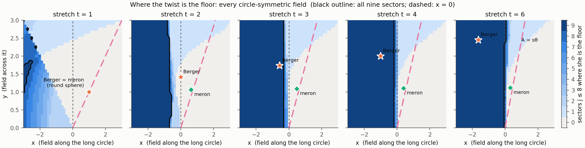
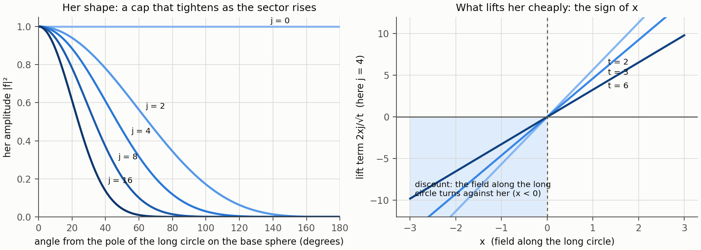

# Looking at her: the closed form and the map of the circle-symmetric family (21 November 2026)

**Status.**
- The closed form is **exact**: symbolic, and checked numerically to 1.4 × 10⁻¹⁵ at 40 random points.
- The map is **exploratory**: double precision, sectors j ≤ 8, not pre-registered. It is meant for looking, and for
  choosing what to pre-register next.

**Scripts:**
- `scripts/ricci_su2_twist_family_closed_form.py` (receipt `twist_family_closed_form.txt`);
- `scripts/ricci_su2_twist_family_map.py` (receipt `twist_family_map.json`);
- `scripts/ricci_su2_twist_family_figures.py` (figures below).

## The family

Take SU(2) on the stretched sphere (t, 1, 1) with a circle-symmetric field: strength **x** along the long circle and
**y** across it (m₀ = x e₀, m₁ = y e₁, m₂ = y e₂). Every background tested so far lies in it:

| background | x | y |
| --- | --- | --- |
| Berger field | (2 − t)/√t | √t |
| A = sθ (Tests 4, 5) | 2s/√t | 2s |
| squashed meron | numerical, x > 0 | numerical |

The twist is alone in her charge block throughout the family, so she is an exact eigenvector everywhere in it.

## The closed form (exact)

λ(x, y, t, j) = (x + (j + 2)/√t)² + 2√t·x − y²

- On the Berger field this is λ_t(j) exactly.
- The cost of lifting her from sector 0 to sector j is (j² + 4j)/t + **2xj/√t**. The second term is a discount
  **if and only if x < 0**, that is, when the field along the long circle turns against her momentum.
- On the Berger field x = (2 − t)/√t changes sign at t = 2. That is the stretch where the Floor paper's Casimir
  remark finds the coupling vanishes. Every background where she failed (the meron and every A = sθ) has x > 0.

## The map (exploratory)

At t = 1, 2, 3, 4 and 6: x from −3 to 3 (49 values), y from 0 to 3 (37 values), and sectors j = 0, …, 8, giving 9,065
cells.

| t | cells where she is the floor of all nine sectors | of those, x < 0 | edge x* (largest x in her region; grid 0.125) |
| --- | --- | --- | --- |
| 1 | 28 | 28 | only near x ≈ −2.2 to −3, larger y |
| 2 | 705 | 705 | in (−0.625, −0.5] |
| 3 | 814 | 814 | in (−0.375, −0.25] |
| 4 | 851 | 851 | in (−0.25, −0.125] |
| 6 | 896 | 888 (8 at x = 0) | in (−0.125, 0] |

- **She lives on one side of a line.** Of 3,294 cells where she is the floor of all nine sectors, every one has
  x ≤ 0, and 3,286 have x < 0.
- **The edge hardly depends on y** for t ≥ 2. It is a nearly vertical line, x = x*(t), and it approaches x = 0 as
  the sphere stretches.
- **The Berger field sits on the correct side every time:**
  - t = 2: x = 0, outside, and indeed not the floor;
  - t = 3, 4, 6: inside, where it is proved to be the floor on [2.75, 10].
- **The meron and the whole A = sθ line lie outside at every t.** That matches every failed test.
- **At t = 1** (the round sphere) her region is small and sits at strongly negative x.

## Her shape

- **Left.** Her amplitude on the base sphere is |f|² = cos^{2j}(η/2), with η the angle from the pole of the long
  circle. She is uniform in sector 0 and gathers into a cap about the pole as the sector rises.
- **Right.** The lift term 2xj/√t. It is a discount only for x < 0, and the discount is larger at smaller stretch.

## What this suggests (to be tested, not claimed)

- **Candidate criterion.** In the circle-symmetric family on (t, 1, 1), the twist is the floor of every sector
  exactly when the field along the long circle turns against her by enough: x < x*(t). The edge x*(t) < 0
  approaches 0 as the stretch grows.
- In my words: the direction governs her. Not the direction of the curvature (Tests 4 and 5 ruled that out), but the
  direction of the field along her own circle.
- **Suggestive, not shown.** The Berger curve x = (2 − t)/√t crosses the edge between t = 2 and t = 3, where its
  known threshold t* ≈ 2.70 sits. If x*(t) is pinned down, the Berger crossing should land on t*.

## Next (to pre-register)

1. Estimate x*(t) finely from this map, at t = 2, 3, 4 and 6 only.
2. Predict the edge at held-out stretches (t = 2.5, 5, 8), and the Berger crossing near t ≈ 2.70, with sectors up to
   j = 12. Then run it.
3. If it holds, try to prove the edge: compare λ with the nearest competitor's block, which is closed-form, in this
   family.
